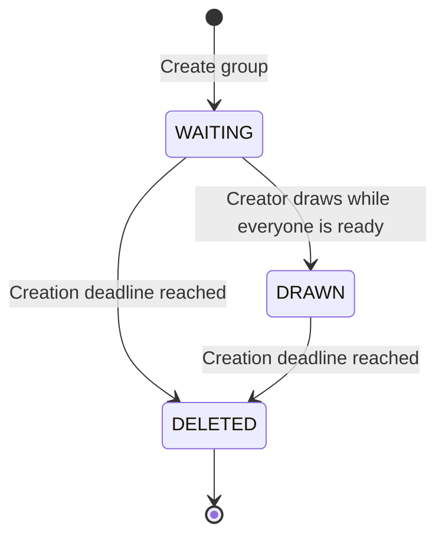

# Secret Santa: requirements and design

Date: 2026-11-16

Status: Draft for review

Scope: Product requirements and technical design; application implementation is outside this documentation task.

## 1. Purpose

Secret Santa helps a group of people organize a gift exchange while connected through their own browsers. The creator supplies the participant list and shares one invitation link. Participants select their names and wait together. The creator starts the draw, and each participant privately sees the person for whom they should buy a gift.

Success means the group can complete one valid, private draw with minimal setup, without accounts or permanent storage.

## 2. Confirmed requirements

| ID | Requirement |
| --- | --- |
| R1 | The creator creates a group with a list of participant names. |
| R2 | The application provides a group code embedded in a shareable link. |
| R3 | Each participant joins through that link and selects their own name. A claimed name becomes unavailable to other participants. |
| R4 | The creator also participates and selects their name. |
| R5 | The creator starts the draw when everyone is connected. |
| R6 | Each participant receives exactly one recipient, each recipient is assigned exactly once, and nobody receives their own name. |
| R7 | Each participant sees only their own recipient. |
| R8 | The draw is final and cannot be repeated within the same group. |
| R9 | The application is a web application with server-side rendering. |
| R10 | The host server serves pages and manages real-time communication between devices. |
| R11 | Group state is stored in memory only, without persistent storage. |
| R12 | Each group expires one hour after creation. Activity and the draw do not reset this deadline. |

## 3. Proposed defaults

These are design proposals, not additional requirements confirmed by the user. They make the draft concrete and can be revised during review.

| Topic | Proposed behavior |
| --- | --- |
| Technical stack | Node.js, TypeScript, Express, EJS, and Socket.IO in one application process. |
| Authentication | No accounts or passwords. Possession of the invitation permits joining; selecting a name is a declaration of identity. |
| Group size | Between 2 and 50 participants, including the creator. With two participants, recipients are necessarily predictable. |
| Names | Trim whitespace; require non-empty labels of at most 80 characters; reject duplicates after Unicode normalization and case-insensitive comparison. Ask people with the same name to use distinct labels. |
| Roster | Fix the participant list at creation. To change it, create a new group. |
| Readiness | Every listed identity must be claimed and have at least one connected browser tab, and the creator session must own one of those identities, before the server accepts a draw. |
| Reconnection | Preserve the selected identity and the same recipient in the same browser until group expiry, using a temporary session cookie. |
| Disconnection | Keep the name claimed; show the participant as disconnected and block drawing until they return. |
| Incorrect claims | Before the draw, participants can release their own claim; the creator can release any claim. Release immediately revokes access for the former claimant. |
| After the draw | Freeze claims and assignments. Unclaimed visitors cannot select an identity or view results. |
| Lost access | No transfer to another browser or device and no recovery after losing the browser session. Before drawing, the creator may release a claim; if creator access is lost, create a new group. |
| Language and devices | English interface, usable on phone and desktop browsers. |

## 4. Goals and boundaries

The first version supports creation, invitation sharing, name selection, live presence, one private draw, reconnection, and automatic expiry.

Accounts, email invitations, wish lists, budgets, exclusion rules between particular people, saved history, group extensions, redraws, multiple server instances, and permanent recovery are outside scope.

The application must never broadcast the complete assignment map, expose creator privileges through the invitation link, or silently redraw after an error. Creating a new group is a separate exchange, with a new code and deadline.

## 5. Approaches considered

### Recommended: Express, EJS, and Socket.IO

Use one Node.js HTTP server with Express routes, EJS templates, and Socket.IO attached to the same server. Express renders the initial HTML; a small browser script subscribes to events and updates the existing page.

This fits a small application with a few pages and temporary groups. It keeps page rendering, authorization, group state, and live connections together. The tradeoff is that browser interactions and DOM updates are organized directly rather than through a component framework.

Express documents rendering HTML through template engines, and EJS provides an Express-compatible HTML template engine. See [Express template engines](https://expressjs.com/en/guide/using-template-engines/) and [EJS](https://ejs.co/).

### Alternative: Next.js with a custom Node.js server and Socket.IO

This offers React components and server rendering, which could help if the interface later becomes substantially larger. A custom server can host the application and Socket.IO together, but introduces framework conventions and deployment considerations. Next.js documents limitations associated with custom servers in its [custom server guide](https://nextjs.org/docs/app/guides/custom-server).

The working recommendation is Express with EJS because the current flow is small. The user delegated the stack proposal; this draft does not record an explicit framework approval.

## 6. User journey

1. **Create:** The creator opens the home page and enters the complete name list, including their own name. The server validates the list and creates the group and its fixed expiry timestamp.
2. **Identify:** The creator selects their name. Creator permission is already bound to their browser session and is independent of the selected participant name.
3. **Invite:** The creator copies a link such as `https://example.com/groups/<code>` and sends it to the group themselves. The application does not send messages.
4. **Join:** Each invitee opens the link, sees the available names, and selects their identity. Already claimed names are unavailable.
5. **Wait:** Everyone sees the participant list, connection status, and expiry time. Only the creator has a draw control, enabled when everyone is ready.
6. **Draw:** The server authorizes the creator, checks readiness and expiry again, computes one assignment map, and stores it before sending results.
7. **Reveal:** Each participant receives only their recipient. The creator sees their own recipient and the completed group status, with no access to other assignments through the application.
8. **Expire:** At the creation deadline, the group becomes unavailable and its server-side state is removed. Connected pages clear the displayed recipient and show an expiry message.

Use server-rendered pages for creation, joining, waiting, results, and errors. JavaScript is required for the live exchange; a browser without it should show a clear explanation.

## 7. Architecture and hosting

The application has four logical parts within one process:

- HTTP routes validate form submissions and render EJS pages.
- A group service owns all domain rules, expiry checks, name claims, and the final draw.
- An in-memory store holds groups and temporary browser sessions.
- Socket.IO handlers publish presence and private results, using the same group service and authorization rules as HTTP routes.

Socket.IO supports bidirectional communication, connection detection, acknowledgments, and automatic reconnection. Its transports include WebSocket and an HTTP long-polling fallback. See [Socket.IO architecture](https://socket.io/docs/v4/how-it-works/).

Deploy one continuously running Node.js process on a host that supports long-lived connections. If a reverse proxy terminates HTTPS, it must forward Socket.IO traffic, including WebSocket upgrades. Serve HTTP and real-time traffic from the same origin.

Do not run independent workers or replicas with separate group stores. Socket routing alone would not synchronize application state between them. Server restarts, crashes, and deployments lose all groups; the interface should explain that a missing group may have expired or been lost after a restart.

## 8. State and lifetime

A group contains:

| Field | Purpose |
| --- | --- |
| `code` | Unguessable invitation identifier; propose at least 128 bits of cryptographic randomness. |
| `createdAt`, `expiresAt` | Server timestamps, with `expiresAt = createdAt + 60 minutes`. |
| `status` | `WAITING` or `DRAWN`. Expiry removes the record rather than retaining an expired record. |
| `creatorSessionId` | Browser session authorized to perform creator actions. |
| `participants` | Stable participant IDs and display names, claim ownership, and active connection IDs. |
| `assignments` | After drawing, a mapping from participant ID to recipient ID. |

`DELETED` describes the absence of server state, not a stored group status. There is no transition from `DRAWN` back to `WAITING`.

Schedule cleanup for each group's deadline and check expiry on every group access and mutation. At or after the deadline, reject the operation, remove the group, revoke its claims and privileges, clear group-specific timers and connection references, and close its group subscriptions. Background cleanup covers groups that receive no further traffic.

Also remove session membership references and unused session records. A browser participating in several groups may retain its session while other unexpired memberships remain. No group-specific server data may remain accessible beyond its deadline. Actual cleanup scheduling and memory reclamation are subject to the runtime; they must not extend logical access.

Group deletion covers server-controlled state. A disconnected browser may retain an already displayed result, so the client should also clear it at the supplied deadline and whenever the page resumes or reconnects. The application cannot erase screenshots or information a participant has already read.

Do not persist group data to a database, files, browser storage, logs, or analytics. A temporary cookie contains only an opaque session token; names, privileges, and assignments remain in server memory. Personal pages and responses use `Cache-Control: no-store`.

## 9. Identity, permissions, and privacy

Use a cryptographically random, opaque session token in an `HttpOnly`, `Secure` production cookie with an appropriate `SameSite` setting. The cookie supports page refreshes and tabs in the same browser. Do not use a Socket.IO connection ID as participant identity: it can change across reconnections. See [Socket.IO client identity guidance](https://socket.io/docs/v4/client-api/).

A session may claim one participant per group. Claiming a name is an atomic server operation: if two devices select it together, only one succeeds. Multiple tabs for the same session share the identity and count as one participant. A participant is connected while at least one authenticated tab is connected.

The invitation code never grants creator permission. The server checks creator ownership for draw and claim-release actions and derives the caller's participant identity from their session rather than trusting a submitted participant ID.

This design assumes people trust one another to select their own names. It does not verify real-world identity, and the creator can reassign claims before drawing. The server operator can inspect in-memory assignments. Private recipient delivery protects participants from seeing other results through the normal application; it does not provide end-to-end encryption against the server.

Validate all HTTP and socket inputs, escape names in templates, enforce same-origin checks for mutations and socket connections, and apply reasonable request, payload, connection, and active-group limits. Exact resource limits and supporting packages are implementation choices. Avoid including invitation codes, session tokens, participant names, or recipients in application or proxy logs; operational logs may record counts and sanitized error categories.

## 10. Final draw rules

The server checks all of the following immediately before drawing:

1. The group exists and is unexpired.
2. The caller owns the creator session.
3. The group is still `WAITING`.
4. Every participant has a claimed identity and at least one active connection.
5. The creator session owns exactly one of those connected participant identities. Creator permission alone is insufficient.

Treat validation, generation, and assignment storage as one atomic group operation. Concurrent requests, releases, disconnections, and expiry cannot interleave with this operation. Recheck the deadline before committing the result if generation takes time. Never rely only on the button's enabled state.

Generate a uniformly shuffled permutation using server-side cryptographic randomness and reject permutations containing a self-assignment. Repeat until a valid permutation is obtained. This gives every valid assignment equal probability; a simple cyclic shift would unnecessarily restrict the possible outcomes. Reciprocal pairs are allowed because there are no additional exclusion rules.

Store the complete assignment map and mark the group `DRAWN` before publishing results. Repeated creator requests after that point acknowledge that the draw already exists; they do not regenerate it or expose anyone else's result. Participant requests to start the draw are rejected.

Send public completion status to the group and send each recipient only to the authenticated session that owns that participant. Each result includes the group expiry timestamp. Never include the complete map in shared events, HTML, embedded page data, or error responses.

If a connection drops after the draw is committed, the assignment remains final and can be retrieved by the same session before expiry. Exact simultaneous display on all devices is not guaranteed by network delivery; the server initiates all private result deliveries from the same committed draw.

## 11. HTTP and real-time contract

The following is a proposed contract; route and event naming may be refined without changing behavior.

| HTTP route | Purpose |
| --- | --- |
| `GET /` | Render the creation page. |
| `POST /groups` | Create a group, bind creator permission to the session, and redirect to the group page. |
| `GET /groups/:code` | Render name selection, waiting, or the caller's private result according to session and group state. |
| `POST /groups/:code/claim` | Claim an available participant ID; redirect back to the group. |
| `POST /groups/:code/release` | Release the caller's claim or, with creator permission, a specified claim while waiting. |
| `POST /groups/:code/draw` | Authorize the creator and commit the final draw. |

After establishing its temporary session through HTTP, the browser connects to Socket.IO and requests `group:subscribe` with the group code. The server authorizes the subscription and immediately returns a fresh, session-specific snapshot. Public fields include names, claimed/connected flags, group status, expiry, and readiness. Only the owner session receives its selected identity, its private recipient when drawn, and its creator capability flag.

| Server event | Audience and payload |
| --- | --- |
| `group:state` | Updated roster, presence, status, deadline, and readiness. No assignments or session tokens. |
| `participant:result` | Owning session only: recipient ID, display name, and expiry. |
| `participant:released` | Revoked session: clear selected identity and return to name selection. |
| `group:expired` | Connected group subscribers: clear local group state and show expiry. |
| `group:error` | Requesting session only: stable error category and safe user-facing message. |

Use full state snapshots with monotonically increasing group revisions so clients can ignore stale updates. HTTP responses after mutations render or redirect to the authoritative state; socket events update other connected devices.

Automatic transport reconnection alone is insufficient. On every subscription or reconnection, read current server state and resend the caller's existing recipient if applicable. Keep Socket.IO packet-history recovery disabled in the initial design to avoid retaining private event history separately from the expiring store.

## 12. Failure behavior

| Situation | Expected behavior |
| --- | --- |
| Invalid list | Explain validation errors; do not create a partial group. |
| Unknown or expired code | Show a group-unavailable page; do not recreate the group implicitly. |
| Name claimed concurrently | Reject the losing claim and refresh available names. |
| Participant disconnects before drawing | Preserve the claim, update presence when detected, and block the draw. |
| Creator disconnects | Keep the group until expiry; allow the same creator session to reconnect. |
| Draw response is lost | A retry reports the existing draw and restores the same private result. |
| Draw overlaps expiry | Reject if the deadline has been reached before commit. |
| Device disconnects immediately after readiness check | If the draw has committed, preserve it and deliver the same result after reconnection. |
| Session is lost after drawing | Do not allow a new browser to reclaim that identity or reveal its recipient. |
| Server restarts | All previous codes become unavailable. |

Presence reflects server-observed connections. Heartbeat-based disconnection detection takes time, so it cannot guarantee that a device is physically reachable at the instant of the draw.

## 13. Acceptance criteria

The future implementation should demonstrate these behaviors:

- **Creation and sharing:** A valid roster creates one group with a unique invitation link, creator permission, and a deadline exactly 60 minutes after creation.
- **Identity ownership:** Concurrent attempts to claim one identity have one winner; one session cannot occupy two names in the same group.
- **Creator participation:** The creator selects one roster identity and receives exactly one recipient like everyone else. Drawing is rejected if the creator has released their claim, even when every name has subsequently been claimed by other sessions.
- **Readiness:** Drawing is rejected until all names are claimed and connected, including when a stale page still displays an enabled control.
- **Authorization:** Non-creators cannot draw or release another person's claim. The shared link does not confer creator authority.
- **Correct assignments:** For supported group sizes, results contain every participant exactly once as a giver and recipient, with no self-assignment. A two-person group swaps recipients.
- **Finality:** Duplicate or concurrent draw requests, refreshes, and reconnects never change an already committed assignment.
- **Privacy:** Each participant's HTML, responses, snapshots, and socket events contain only their own assignment. Public group events contain no assignment map.
- **Recovery:** A brief interruption or page refresh in the same browser restores identity and the existing result before expiry. Multiple tabs do not create extra participants.
- **Release:** Releasing a claim before drawing revokes the old session's participant access and makes the identity available; release is rejected after drawing.
- **Expiry:** Activity never changes the deadline. At the deadline, access and mutations are rejected, connected pages clear results, and server cleanup removes group state even without new requests.
- **Storage:** No database, group files, recipient browser storage, or personal-data logs are produced. A restart loses all active groups.
- **Rendering and live behavior:** Initial pages contain server-rendered content, and participant status and private results update across separate browser sessions without manual refresh.

These are verification targets for later implementation, not claims that application tests currently exist or pass.

## 14. Decisions left to implementation

The builder may select exact supported dependency versions, stylesheet organization, visual styling, internal module boundaries, test tools, deployment provider, and capacity limits. Those choices must preserve the single-process architecture, private final draw, server rendering, and fixed group lifetime.

Any change to accounts, roster editing, redraws, cross-device recovery, storage, expiry, or multiple server instances changes this design and should be discussed separately.
